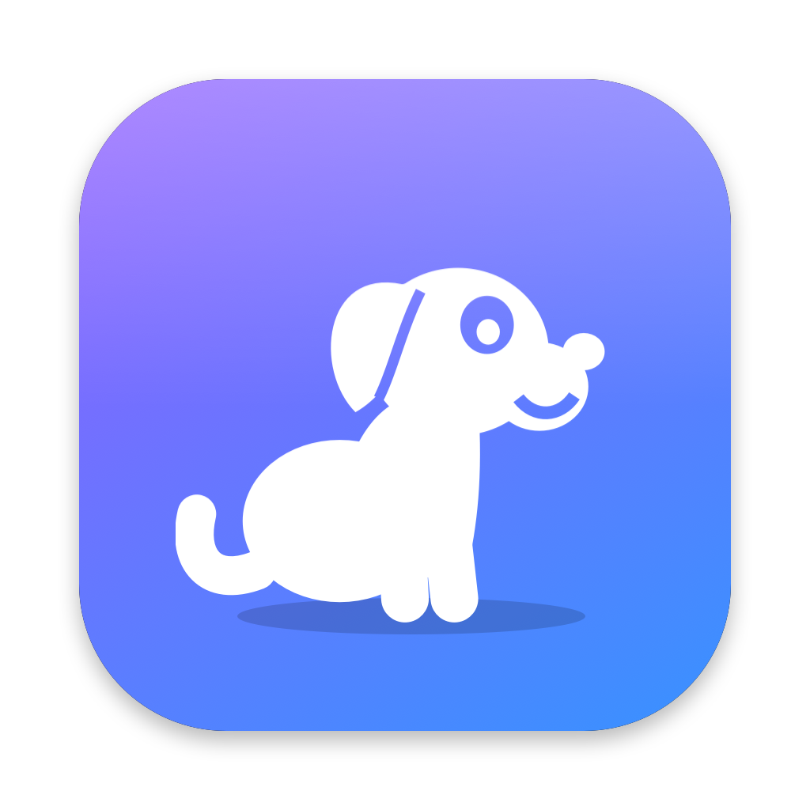
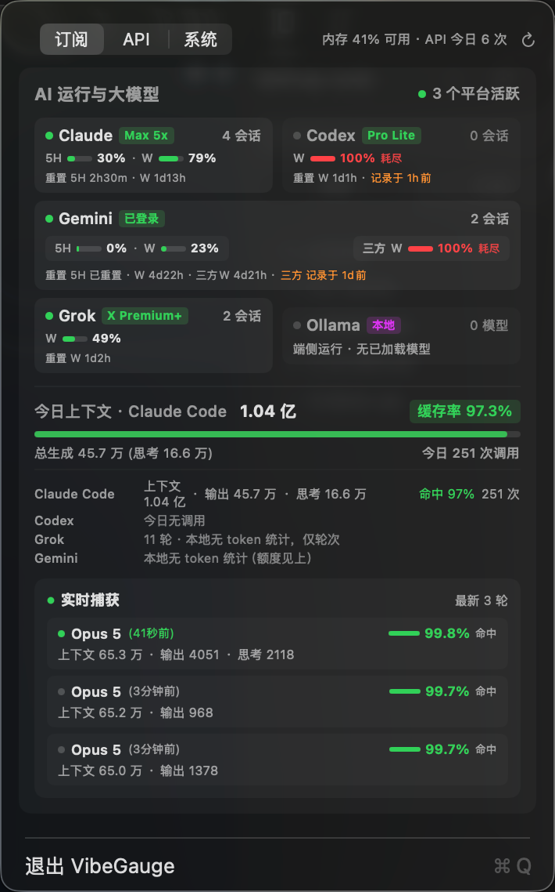
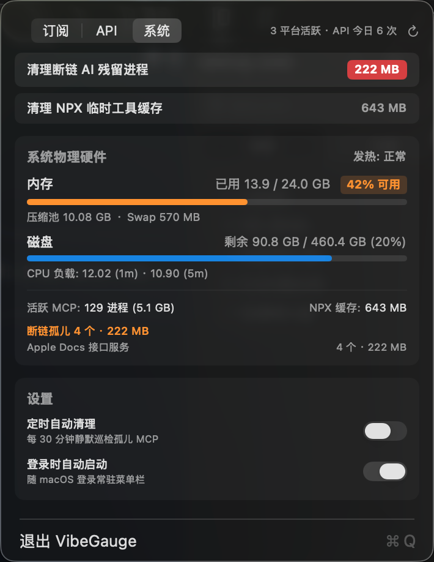

# VibeDeck 🧠

<p align="center">
  
</p>

<h3 align="center">专为 Vibe Coding 打造的 macOS 极简原生菜单栏仪表盘</h3>

<p align="center">
  <b>一键回收断链 MCP 孤儿进程 · 实时聚合各家大模型额度与 5H/周重置倒计时 · Prompt Cache 命中率与 Token 成本透明监控</b>
</p>

<p align="center">
  <a href="https://github.com/xixilys/vibedeck/releases"></a>
  
  
  
  
  <a href="./LICENSE"></a>
</p>

<p align="center">
  <a href="README.md">🇺🇸 English</a> •
  <b>🇨🇳 简体中文</b>
</p>

> **Fork 声明。** VibeDeck fork 自 [@MaxHaiCom](https://github.com/MaxHaiCom) 的 [**VibeGauge**](https://github.com/MaxHaiCom/vibe-gauge)，遵循 MIT 许可证。原版应用的功劳归原作者；本 fork 由 [@xixilys](https://github.com/xixilys) 独立维护，与上游没有隶属关系，也未获上游背书。
>
> **本 fork 新增：** 半透明玻璃面板重设计 · 跨本机/远端设备的账号额度卡片 · Codex 进程监控 · 系统页（CPU / GPU / 内存 / 温度）· 通过特权 helper 的 SMC 风扇控制，“智能温控”以最热核心为目标、PI 平滑调速 · 各设备首 token 延迟 · 多币种当日合计 · 所有系统探测都有超时，失效的网络挂载不会再卡死扫描。
>
> Bundle ID 为 `io.github.xixilys.vibedeck`，可与上游 VibeGauge 并存，互不共享设置。

---

<p align="center">
  
  &nbsp;
  
</p>

---

## 💡 为什么需要 VibeDeck？

在深度使用 **Claude Code**、**OpenAI Codex**、**Google Antigravity (agy)**、**Grok CLI** 进行 AI 辅助编程（Vibe Coding）时，开发者普遍面临三类难以忍受的痛点：

1. **🧟‍♂️ MCP 僵尸进程吞噬内存**：
   频繁调起或重启各家 Agent 时，后台残留大量无头 `node` / `python` MCP 服务进程（`PPID == 1`）。往往几天下来，几百个孤儿进程悄悄吃掉 **5GB ~ 10GB 物理内存**，引发系统 Swap 暴涨、机器发热卡顿。
2. **⏳ 额度黑盒与「重置焦虑」**：
   各家的配额窗口各不相同——Claude 的 5 小时动态滚动窗口与 7 天上限、Codex 的周限额度、Gemini/Grok 的用量池……想要知道额度用完了没有、几点几分重置，只能在终端里反复碰壁，或者登录网页查看。
3. **📊 Token 成本与 Prompt Cache 盲区**：
   今天到底跑了几轮对话？上下文塞了多少亿 Token？Prompt Cache 命中率到底有没有达到 90%+ 帮你省钱？本地第三方国内模型（GLM、DeepSeek、Kimi、MiniMax）跑了多少用量？

**VibeDeck** 由纯 Swift + AppKit + SwiftUI 原生打造，**零第三方依赖、零网络外发、纯本地只读解析**，将整个 Vibe Coding 研发状态浓缩于 Mac 菜单栏中。

---

## ✨ 核心特性

- 🧹 **一键回收孤儿 MCP 进程**：内置严格的三层安全放行规则（仅回收父进程已死 `PPID=1`、无端口监听、不在系统白名单、具有 MCP 特征签名的 node/python 进程），绝不误杀开发环境；支持一键清空 `~/.npm/_npx` 缓存。
- ⏱️ **全平台额度与重置倒计时**：
  - **Claude**：实时截获当前订阅档位（Max 5x / Max 20x / Pro / Team）、5 小时窗口已用百分比、7 天上限以及精准至分秒的重置时刻。
  - **Codex**：解析主桶配额与打满状态，智能识别 `usage_limit_exceeded` 确切解封时刻；支持多台远程机器（WSL / Linux / 其他 Mac）SSH 免密拉取同步。
  - **Gemini / Antigravity**：实时跟踪官方池与三方池额度、重置周期。
  - **Grok**：实时读取周用量百分比与周期重置时间。
  - **本地运行探测**：探测 Ollama / LM Studio 等本地模型服务活跃状态。
- 🧮 **opencode 与国产模型用量**：
  - 读取 opencode 本地 SQLite 库的逐条消息用量，把 DeepSeek / GLM / Kimi 等国产模型算进「统计」标签。
  - 可选 SSH 免密拉取 WSL / Linux / 其他 Mac 的用量，按主机分列（如 `OpenCode · wsl-box`）。
- 📈 **今日 Token 用量与缓存命中率大盘**：
  - 汇总今日总调用轮次、亿级上下文规模、输出 Token、思考（Thinking）Token。
  - 实时计算 Prompt Cache 命中率（精准展示 97%+ 缓存命中）。
  - 最近 3 轮交互动态回放（模型类型、耗时、思考消耗、缓存命中度）。
- 💰 **按天的 API 等价花费与金额预测**（口径对齐 ccusage）：
  - 内置参考目录（`Resources/prices.builtin.json`），OpenAI 新模型按官方文档核实，其他条目标明参考来源与日期；**不配置也能看到金额**，你的 `prices.json` 永远优先。面板底部「模型价格」可搜索模型、查看输入/输出/缓存单价、来源与长上下文规则。
  - 计价考虑缓存读 / 写、Claude 1 小时缓存写入（2× 输入价）、长上下文整单升档、Codex priority / Claude fast 档。
  - Claude 同一 requestId 取 token 最多的那条（流式分块不重复算）；Codex 新版逐请求 `token_usage_record` 按 response_id 去重，`sessions/` 与 `archived_sessions/` 同名文件只算一次，旧版 fork 重放的父会话用量跳过。
  - 今日预测：按近 28 天的作息曲线和余量法加权，历史不足时只作短时估计。本月需至少 7 个过去记录日才外推，否则显示月累计；区间表示历史波动，不是概率置信区间。设备筛选同时作用于费用、预测与热力图；Claude 本机当前 5 小时计费块单独推算。
- 🖥️ **WSL / Linux / 其他 Mac 的每日用量**：
  - 自动发现 Herdr 中已启用的 SSH 设备，与手动 `remoteHosts` 合并；首页按平台集中展示各设备的 Claude / Codex / Grok / Antigravity 额度，不必反复切设备。同一账号的百分比不相加，过期、时间未知、缺失和上次记录分别提示；能否显示真实额度取决于各 CLI 是否提供本地元数据。
  - 今日用量区分新输入和缓存读取，输出已包含思考。API 等价估算放在用量下方，预测保留在统计页；本机历史先显示，远端慢或连接失败时保留缓存并注明原因。
  - SSH：`remoteHosts` 里的主机每 5 分钟增量拉取 Claude / Codex / opencode 的逐条记录（按文件 mtime 游标 + 压缩传输），远端只需 `python3`。
  - 挂载目录：已把那台机器的家目录挂到本机（SMB / sshfs / `\\wsl$`），配 `mountRoots` 直接读，口径与本机一致。
  - 面板顶部「设备」切换，按设备看今日用量、历史与花费。
- 🧠 **模型降智检测**（思路来自 [is-gpt-nerfed](https://github.com/kiyoakii/is-gpt-nerfed)，被动检测 0 token）：
  - Codex：没改设置却换了更弱的模型、调低了推理级别、跑了隐藏的内部模型（如 `gpt-reserve`）、上下文窗口变小 → 硬证据；通过设置改的只提示「是你改的吗？」。
  - Claude Code：主对话里没用 `/model` 却从 Opus 换到 Sonnet 之类 → 硬证据；来回切换（opusplan 这类自动路由）只提示；API 错误 / 过载偏多单独提示。
  - 行为统计：今天每次请求的平均输出、思考占比明显低于近两周中位数 → 可疑（仅供参考）。
  - 装了 is-gpt-nerfed 会读取它的 ModelTrace 指纹结论一起展示；发现硬证据时菜单栏图标右上角出现圆点并发通知。
- 🔌 **内置无感 API Key 记账代理（可选）**：
  - 针对直接调用 API Key 的场景（如 Claude Code 接国内模型、脚本接入、Hermes 等），提供极轻量本地代理（监听 `127.0.0.1:18790`）。
  - 支持 **GLM Coding Plan**、**OpenRouter**、**DeepSeek**、**Kimi**、**MiniMax** 等国内外厂商的自动余额与套餐抓取。
  - **极致安全**：API Key 仅在内存临时处理，**绝不落盘、绝不外发**，日志仅记录截断指纹。
- 🖥️ **macOS 极简原生体验**：
  - 原生 Swift 编译，内存占用仅约十几 MB，极速启动。
  - 菜单栏图标动态嵌入系统当前内存可用百分比。
  - 面板高度根据内容自适应，支持**触控板双指左右轻扫无缝切换 Tab**。

---

## 🚀 快速使用

### 方式一：直接下载预编译 App（推荐）

> Universal 通用包：**Apple Silicon 与 Intel** Mac 均可运行，需 **macOS 14+**。界面语言跟随系统（简体中文 / English）。

1. 前往 [GitHub Releases](https://github.com/xixilys/vibedeck/releases) 下载最新版 `VibeDeck.zip`。
2. 解压并将 `VibeDeck.app` 拖入 `/Applications`（应用程序）目录。
3. 双击打开，图标即会常驻在菜单栏右上角。

> **提示**：首次打开如遇 macOS 安全提示，请在「系统设置」→「隐私与安全性」中点击「仍要打开」。若使用了 Bartender 等菜单栏收纳工具，请检查图标是否被收拢在隐藏区。

---

### 方式二：本地 3 秒编译构建（零依赖，无需完整 Xcode）

只需系统自带的 `swiftc`（安装 Command Line Tools 即可，无需打开或安装几十 GB 的 Xcode）：

```bash
# 1. 克隆代码仓库
git clone https://github.com/xixilys/vibedeck.git
cd vibedeck

# 2. 一键编译并打包
./build.sh

# 3. 启动应用
open VibeDeck.app
```

#### 命令行自测与无头模式

```bash
# 校验纯函数逻辑并打印一次全量扫描快照（不启动 UI）
./VibeDeck.app/Contents/MacOS/VibeDeck --selftest

# 启用/卸载 API 记账代理服务（基于 LaunchAgent）
./VibeDeck.app/Contents/MacOS/VibeDeck --install-proxy
./VibeDeck.app/Contents/MacOS/VibeDeck --uninstall-proxy
```

---

## 🔍 数据采集来源与更新机制

**覆盖范围**：token 与 API 等价费用来自已采集的本机、SSH 和挂载设备会话记录。「全部」的今日 token 合并这些设备；首次历史扫描完成后，与统计页使用同一份当日记录，包含归档会话。**Dot 启动的 Codex 云端任务目前尚未接入用量统计**：在 Mac 上运行工具不会生成对应的本地模型用量日志，未取得的云端用量不按零消耗解释，也不从配额百分比或上下文长度推算。

所有数据均来自于各家 CLI 本地产生的会话文件或官方接口缓存，**查不到即标明「无数据」，坚决不随意猜测**：

| 平台 | 订阅档位识别 | 额度与重置时间来源 | 数据更新时机 |
|:---|:---|:---|:---|
| **Claude** | `~/.claude.json`<br>（如 `max_5x` / `max_20x` / `pro`） | `~/.claude/claude-usage.json`<br>（Statusline 截获的 5h / 7d 额度与重置点） | 每次与 Claude Code 对话交互时自动刷新 |
| **Codex** | `~/.codex/auth.json`<br>（JWT 包含的 `plan_type`） | 会话日志中的 `rate_limits`<br>打满时精准解析 `task_complete` 中的解封时间 | 仅在发出请求时写入；支持可选 SSH 远程多端同步 |
| **Gemini** | 检测本地鉴权标识与登录态 | `~/.cache/agy-hud/quota_cache.json`<br>（区分官方主池与三方模型副池） | 运行 agy 时由对应缓存服务静默写入 |
| **Grok** | `~/.grok/settings_cache.json` | `~/.grok/logs/unified.jsonl`<br>（解析 billing 信用百分比与周期截止时刻） | Grok 运行期间由后台定期刷回本地 |
| **opencode** | opencode 自己的 SQLite 库<br>（每条消息的 `providerID` / `modelID`） | 非额度制<br>（`~/.local/share/opencode/opencode.db` 逐条消息 token） | 每次统计扫描整表重读 |
| **Ollama / 本地** | 探测本地服务端口与进程 | 无云端额度约束（直接显示端侧运行状态） | 实时探测活跃模型 |

> 📌 **注**：卡片脚注提示的「记录于 Nh前」是**上游 CLI 数据源本身的写入时间**，而非 VibeDeck 未刷新。面板打开时每 5 秒读取已有快照，关闭后释放视图。进程与额度每 8 秒采集，菜单打开时也继续运行；面板不再重复启动扫描，菜单栏图标未变化时复用。

---

## 🛠️ 国内模型 & API Key 记账代理（可选）

对于通过修改 `BASE_URL` 直接打各大模型 API 的场景，开启内置透明记账代理后，无需任何繁琐配置即可完成 Token 消耗与余额监控：

1. **安装启动代理**：
   在面板「API」标签页中点击「安装 API 记账代理」，或在终端运行：
   ```bash
   ./VibeDeck.app/Contents/MacOS/VibeDeck --install-proxy
   ```
   代理常驻监听在 `127.0.0.1:18790`。

2. **零配置路由注入**：
   只需在目标服务的 `BASE_URL` 前追加代理前缀即可，例如：
   ```bash
   # GLM 智谱
   export ANTHROPIC_BASE_URL=http://127.0.0.1:18790/https://open.bigmodel.cn/api/anthropic
   
   # DeepSeek 深度求索
   export OPENAI_BASE_URL=http://127.0.0.1:18790/https://api.deepseek.com/v1
   ```
   *(一行命令自动为 `~/.zshrc` 内所有 ANTHROPIC_BASE_URL 添加前缀，自动生成备份：)*
   ```bash
   perl -pi.bak -e 's#(ANTHROPIC_BASE_URL=["\x27]?)(?!http://127\.0\.0\.1:18790/)(https?://)#$1http://127.0.0.1:18790/$2#' ~/.zshrc
   ```

3. **支持的厂商额度与余额反查**：
   - **GLM Coding Plan**：支持 5H / 周配额与档位等级抓取
   - **OpenRouter**：余额与实时 Credits 消耗
   - **DeepSeek**：官方文档余额接口
   - **Kimi / MiniMax / 火山方舟 / 小米 MiMo** 等均支持 Token 流式记账

---

## ⚙️ 配置（可选）

零配置即可使用，下面这些只在需要扩展功能时才配。

**价目表** — 内置参考目录随版本更新，各模型来源见「模型价格」页。GPT-6.1 Sol 使用[官方定价](https://developers.openai.com/api/docs/models/gpt-6.1-sol)：每百万 token 输入 $2、缓存读 $0.10、缓存写 $2.50、输出 $10；超过 272K 输入按整次请求的长上下文档计，Fast 使用对应加速价。自定义价格写在 `~/.config/vibedeck/prices.json`，它不自动继承内置倍率。自定义行可设置 `fast_multiplier`（例如 Astra 为 `2`），对日志标为 `priority` / `fast` 的请求加价：先选择峰谷单价，再将输入、缓存和输出费用乘一次倍率。省略或设为 `1` 表示不额外加价，适用于已经包含 Fast 的最终价。每行可设置 `currency`，支持 `_peak` 与行内 `offpeak`；各币种分别显示，不换算。

价格页的同步从 **models.dev** 补齐内置未覆盖的模型，刷新来源明确且未被手改的自动价。手动价及旧版来源不明的行保留；内置模型不会被同步成缺少长上下文规则的平价行。写回前备份，文件在同步期间被编辑则停止写回。也可运行 `VibeDeck --sync-prices`；模型匹配不到时显示「未定价」，不猜价。

峰谷窗口支持 `_peak.weekdays`（Calendar 星期编号：周日 1、周一 2 … 周六 7）与 `excluded_dates`（`YYYY-MM-DD`），按配置时区判断。节假日是显式参考日历，需要随年份更新；应用不自行猜测厂商的放假与渠道计费规则。

**字体大小** — 面板「系统」标签的「设置」里可直接选（小 / 标准 / 大 / 特大 / 超大），菜单里也有「字体大小」快捷项；改完立即生效。
```bash
mkdir -p ~/.config/vibedeck
curl -fsSL https://raw.githubusercontent.com/xixilys/vibedeck/main/Resources/prices.example.json -o ~/.config/vibedeck/prices.json
# 然后填每百万 token 单价；模型名按最长前缀匹配
```

**按请求数计的套餐上限** — `~/.config/vibedeck/plans.json`（参考 [`Resources/plans.example.json`](Resources/plans.example.json)）。没有用量接口的 Coding Plan，额度 = 经本机代理的请求数 ÷ 你填的上限，面板一律标「估算」。

**高级设置**（`defaults write io.github.xixilys.vibedeck <键> <值>`，改完重启 App）：

| 键 | 默认 | 作用 |
|----|------|------|
| `logRetentionDays` | `30` | 超过这么多天的会话记录会列为可清理（下限 7） |
| `clashAPI` | `http://127.0.0.1:9090` | 网络 Tab 读取的 Clash / mihomo / sing-box 控制端口（只允许本机地址） |
| `clashSecret` | — | 控制端口密钥（如果设了） |
| `remoteHosts` | 关闭 | 空格 / 逗号分隔的 `user@host` 列表，需免密 SSH；合并 WSL / Linux / 其他 Mac 的 Claude / Codex / opencode 每日用量与 Codex 额度。旧的单机键 `codexRemoteHost` 仍认 |
| `mountRoots` | 关闭 | `标签=家目录` 列表（`;` 分隔），如 `wsl=/Volumes/wsl/home/me`；直接读挂载进来的 `.claude` / `.codex` 日志，标签就是面板里的设备名 |

---

## 🗑️ 卸载

```bash
/Applications/VibeDeck.app/Contents/MacOS/VibeDeck --uninstall-proxy   # 装过记账代理才需要
rm -rf /Applications/VibeDeck.app ~/.config/vibedeck
defaults delete io.github.xixilys.vibedeck
```
若开启过「开机自启」，先在菜单里关掉（或到 系统设置 → 通用 → 登录项 移除）。别忘了把 `*_BASE_URL` 里的 `http://127.0.0.1:18790/` 前缀删掉。

---

## 🛡️ 安全与隐私边界

- 🔒 **100% 纯本地运行**：不设置任何云端中转服务器，不上传任何用量数据、Token 记录与机器标识。
- 🔑 **API Key 零落盘**：记账代理截获的 API Key 仅暂存于内存中用于查询厂商余额，写入日志时强制抹除并仅保留 SHA-256 前 8 位脱敏指纹。
- ⚙️ **无入侵性**：仅只读扫描本地日志，不篡改任何 CLI 的凭据文件，不代理 OAuth 登录流程。
- 🛡️ **严格的放行防护**：孤儿进程清理具备多重放行过滤器，确保绝对不误触系统关键进程与正常运行中的开发任务。

---

## 🤝 贡献与反馈

欢迎提交 Issue 与 Pull Request，流程见 [CONTRIBUTING.md](CONTRIBUTING.md)；安全问题请私密报告，见 [SECURITY.md](SECURITY.md)。
- 如果你发现了新的 MCP 孤儿进程签名，欢迎补充至放行/识别规则中。
- 如果某家 CLI 升级了日志格式或下发了新的额度字段，欢迎提 Issue 协助适配。

---

## 📄 开源许可

本项目遵循 [MIT License](LICENSE)。
